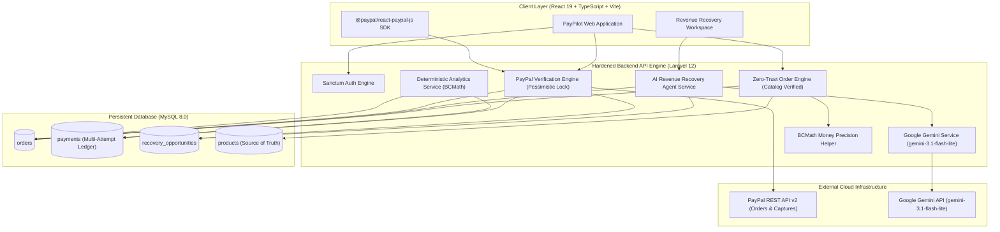
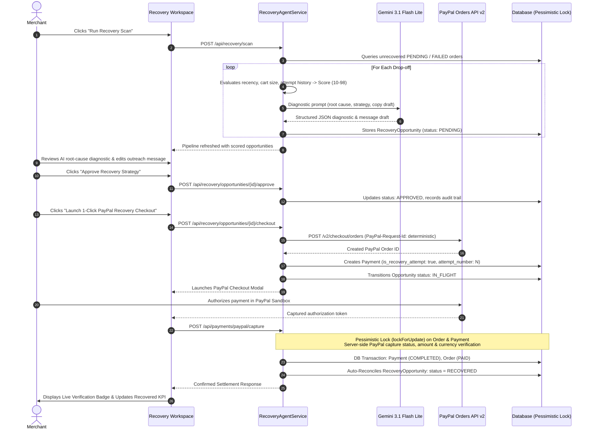

# PayPilot AI 🚀
### Enterprise AI Revenue Recovery, Human-Authorized Commerce & PayPal v2 Settlement Platform

[-003087?style=for-the-badge&logo=paypal&logoColor=white)](https://developer.paypal.com/)
[](https://ai.google.dev/)
[](https://laravel.com/)
[](https://react.dev/)
[](https://tailwindcss.com/)
[](https://opensource.org/licenses/MIT)

**PayPal AI Hackathon 2026 Submission**  
**Repository:** [https://github.com/irfan-ibtech/PayPilot-AI.git](https://github.com/irfan-ibtech/PayPilot-AI.git)  
**Security & Architecture Audit Report:** [AUDIT_REPORT.md](AUDIT_REPORT.md)

---

## 📌 Executive Summary

Every year, global e-commerce merchants lose **over \$18 billion to checkout drop-offs, transient payment authorization interruptions, and unrecovered cart friction**. Traditional cart recovery relies on generic spam emails, while store payment workflows operate disconnected from real-time financial telemetry.

**PayPilot AI** modernizes SMB and enterprise commerce by deploying a **Human-Authorized AI Revenue Recovery Agent** coupled with an end-to-end, zero-trust commerce operating system:

1. **AI Natural Language Order Assistant:** Parse messy merchant quotes and verbal descriptions into structured line items using Google Gemini (configurable model, defaults to `gemini-3.1-flash-lite`).
2. **Catalog-Enforced Zero-Trust Pricing:** LLM mathematical output is never trusted. Prices are resolved strictly against merchant database catalogs, and all subtotals/totals are calculated via BCMath arbitrary precision (`scale = 2`).
3. **Instant PayPal REST API v2 Checkout:** Native integration with PayPal Orders v2 with multi-attempt ledger history and upstream `PayPal-Request-Id` idempotency.
4. **Pessimistic Concurrency & Anti-Tampering Engine:** Database transactions lock rows (`lockForUpdate()`) to prevent race conditions across webhooks, user retries, and AI automated captures. Captured values and currencies are mathematically verified before settlement.
5. **Human-Authorized AI Revenue Recovery Agent:** Scans unrecovered drop-offs (orders with failed payment attempts, explicit abandonment, or age > 15 minutes), calculates explainable heuristic priority scores (10–98), performs root-cause diagnostics, drafts customer outreach copy, and prepares 1-click PayPal recovery checkouts under strict merchant approval.
6. **Deterministic Financial Analytics & Gemini Copilot:** Ingests settled telemetry into a deterministic analytics engine to provide ground-truth CFO dashboards and executive recommendations.

---

## 🏗️ System Architecture & Workflow Topology

### 1. High-Level Component Topology



---

### 2. AI Revenue Recovery State Machine & PayPal Reconciliation Loop



---

## 🔒 Enterprise Fintech Hardening & Security Guarantees

PayPilot AI was engineered under strict fintech security standards, eliminating typical floating-point drift and AI hallucination attack vectors:

### 1. Arbitrary Precision Financial Calculations (`App\Support\Money`)
IEEE 754 floating-point numbers cannot accurately represent decimal fractions. PayPilot replaces all native float casting and `round()` operations with an immutable BCMath wrapper `Money.php` enforcing scale 2:
- Subtotals, line totals, and fees: `bcadd`, `bcsub`, `bcmul`, `bcdiv`.
- Comparisons: `Money::equals($capturedAmount, $orderTotal)` uses `bccomp` with exact zero tolerance ($0.00$).

### 2. Multi-Attempt Ledger & Upstream Idempotency
- **Multi-Attempt History:** When checkouts fail or are retried, previous payment records are preserved with `attempt_number`, `idempotency_key`, `failure_reason`, and `is_recovery_attempt`.
- **`PayPal-Request-Id` Injection:** Every outbound order creation and capture request to PayPal generates a unique, deterministic request ID to prevent duplicate transactions on PayPal's ledger.

### 3. Concurrency Protection (`lockForUpdate()`)
Payment capture requests in `PaymentController::capturePayPalOrder` are wrapped within database transactions that acquire pessimistic row locks on both `Payment` and `Order` models before inspecting status or issuing captures. This prevents race conditions between double-clicks, webhooks, and background recovery jobs.

### 4. Catalog Price Binding in Natural Language Order Parsing
When extracting orders from natural language, `AIOrderController::parse()` matches extracted names against the merchant's authenticated `Product` catalog. If matched, the price is pulled directly from `products.unit_price`, binding `product_id` and setting `catalog_matched: true`. Prompt injection attacks attempting to purchase items for \$0.01 are neutralized.

### 5. Gemini 3.1 Flash Lite Upgrade & Robust Timeouts
- Uses Google's fast and highly efficient `gemini-3.1-flash-lite` model for reasoning and strict JSON schema adherence.
- Outbound requests feature strict HTTP timeouts (`timeout: 15s`, `connectTimeout: 5s`).
- Prompts are automatically sanitized to neutralize prompt injection vectors.

### 6. PayPal REST API v2 Sandbox Testing Notice
- All payment operations in this submission interface with the authentic **PayPal Sandbox environment** (`https://api-m.sandbox.paypal.com`).
- Sandbox transactions utilize virtual buyer balances and developer test cards; no real monetary funds are charged or settled during evaluation.
- Simulated captures for offline development are strictly segregated from genuine PayPal captures via the `is_simulated` schema flag and accounting partitions.

---

## ⚡ Key Modules & Features

- **Revenue Recovery Workspace (`/recovery`):**
  - KPI Ribbon: Recoverable Revenue, Captured Recoveries, Pending Review, Recovery Win Rate.
  - Split-pane interface: Pipeline Queue on the left, Diagnostic & Inspector on the right.
  - Explainable heuristic scoring engine (10–98) with priority badges (`high`, `medium`, `standard`).
  - AI Root Cause Analysis & Behavioral Reasoning via Gemini.
  - Zero-Trust Customer Message Draft with 1-click clipboard copy.
  - Human-in-the-loop approval state machine (`PENDING` -> `APPROVED` -> `IN_FLIGHT` -> `RECOVERED` / `REJECTED`).
  - Application-level append-only payment event log tracking every actor and state transition.
- **AI Order Assistant (`/assistant`):**
  - Natural-language quote parsing into structured baskets.
  - Catalog price verification tags.
  - Server-side zero-trust price recalculation.
  - 1-click PayPal checkout launch.
- **Deterministic Analytics & CFO Copilot (`/dashboard` & `/copilot`):**
  - Live vs Demo Seed telemetry badges.
  - Verified revenue, average order value, conversion rates, and 7-day volume charts.
  - Conversational business copilot grounded in store transaction telemetry.

---

## 🧪 Automated Security Regression Suite

PayPilot AI includes a comprehensive automated test suite with **100% pass rate** covering payment security, idempotency, and the revenue recovery agent lifecycle:

```bash
cd backend
php artisan test
```

### Test Suite Summary:
```
 PASS  Tests\Feature\ExampleTest
 ✓ it returns a successful response

 PASS  Tests\Feature\PayPalSandboxIntegrationTest
 ✓ missing credentials throws clear configuration error
 ✓ invalid credentials throws clear authentication error
 ✓ order creation throws exception on paypal error without silent simulation
 ✓ genuine paypal capture sets is simulated false and marks order paid
 ✓ simulated captures do not increment genuine recovered revenue
 ✓ reconciliation queries paypal api and syncs completed state
 ✓ network timeout during capture transitions to requires reconciliation
 ✓ currency mismatch during capture is rejected
 ✓ unapproved recovery checkout is strictly blocked
 ✓ cross merchant recovery opportunity access is blocked

 PASS  Tests\Feature\PaymentSecurityTest
 ✓ rejects tampered or mismatched payment amount on capture
 ✓ idempotent capture returns cached success without duplicate processing
 ✓ multi attempt ledger increments attempt number and records idempotency key
 ✓ tenant isolation prevents capturing another merchant order
 ✓ ai order catalog price resolution overrides untrusted prompt prices

 PASS  Tests\Feature\RecoveryAgentTest
 ✓ scan identifies unrecovered dropoffs and scores recovery potential
 ✓ merchant can approve opportunity and record audit trail
 ✓ merchant can reject opportunity
 ✓ launch recovery checkout creates paypal order with recovery flag
 ✓ capturing paypal order reconciles active recovery opportunity to recovered
 ✓ recovery metrics endpoint aggregates deterministic pipeline totals

Tests:    23 passed (113 assertions)
Duration: 4.38s
```

---

## 🚀 Quick-Start Installation Guide

### Prerequisites
- **PHP 8.2+** with extensions: `pdo_mysql`, `curl`, `mbstring`, `openssl`, `bcmath`
- **Composer 2.x**
- **Node.js 18+** & **npm**
- **MySQL 8.0+** (Native on port `3306` or via MAMP on port `8889`)

---

### Step 1: Clone Repository
```bash
git clone https://github.com/irfan-ibtech/PayPilot-AI.git
cd PayPilot-AI
```

---

### Step 2: Configure & Run Backend

1. Navigate to backend directory and install dependencies:
   ```bash
   cd backend
   composer install
   ```

2. Configure environment file:
   ```bash
   cp .env.example .env
   php artisan key:generate
   ```

3. Configure your database and API credentials in `backend/.env`:
   ```env
   APP_NAME="PayPilot AI API"
   APP_URL=http://localhost:8000
   FRONTEND_URL=http://localhost:5173

   DB_CONNECTION=mysql
   DB_HOST=127.0.0.1
   DB_PORT=8889              # Or 3306 depending on your MySQL setup
   DB_DATABASE=paypilot_ai
   DB_USERNAME=root
   DB_PASSWORD=root

   CORS_ALLOWED_ORIGINS=http://localhost:5173

   # PayPal Sandbox Credentials
   PAYPAL_MODE=sandbox
   PAYPAL_CLIENT_ID=your_paypal_sandbox_client_id
   PAYPAL_CLIENT_SECRET=your_paypal_sandbox_secret

   # Google Gemini API Key
   GEMINI_API_KEY=your_gemini_api_key
   GEMINI_MODEL=gemini-3.1-flash-lite
   ```

4. Run migrations and database seeder:
   ```bash
   php artisan migrate:fresh --seed
   ```
   *Seeder automatically provisions:*
   - Demo Merchant: `demo@paypilot.ai` / `password123`
   - 5 catalog items
   - Historical orders and telemetry (tagged `is_demo_seed = true`)
   - Initial AI Revenue Recovery opportunities ready for immediate inspection.

5. Start the backend development server:
   ```bash
   php artisan serve --port=8000
   ```

---

### Step 3: Configure & Run Frontend

1. In a separate terminal, navigate to `frontend/`:
   ```bash
   cd frontend
   npm install
   ```

2. Start the Vite development server:
   ```bash
   npm run dev
   ```
   Open [http://localhost:5173](http://localhost:5173) in your browser.

3. Log in with the pre-seeded demo merchant credentials:
   - **Email:** `demo@paypilot.ai`
   - **Password:** `password123`
   *(Or click "Fill Hackathon Demo Credentials" for 1-click login).*

---

## 📹 Hackathon & Devpost Submission Details

- **Hackathon:** PayPal AI Hackathon 2026
- **Category:** AI Agents & Intelligent Merchant Payment Solutions
- **Lead Architect & Engineer:** Muhammad Irfan Bashir ([@irfan-ibtech](https://github.com/irfan-ibtech))
- **Audit Documentation:** [AUDIT_REPORT.md](AUDIT_REPORT.md)
- **Status Dashboard:** [PROJECT_STATUS.md](PROJECT_STATUS.md)

---

## ⚖️ Hackathon Evaluation Readiness & Outstanding Production Disclosures

PayPilot AI is **Hackathon Evaluation-Ready** against the authentic PayPal Sandbox environment (`api-m.sandbox.paypal.com`).

### Verified Sandbox Capabilities:
- Live OAuth2 token issuance against PayPal Sandbox.
- Live PayPal v2 Order Creation (`POST /v2/checkout/orders`) with upstream idempotency (`PayPal-Request-Id`).
- Real-time order inquiry (`GET /v2/checkout/orders/{id}`) and pre-approval capture rejection (HTTP 422 `ORDER_NOT_APPROVED`).
- Dedicated recovery checkout session generation with strict merchant approval gates.
- **Verified Human-Approved Recovery Payment Lifecycle:** End-to-end buyer approval completed by human operator using a Sandbox Personal Buyer account on `sandbox.paypal.com`; backend server-side capture confirmed via PayPal API (Capture ID: `3FL64688SL0637948`, `$69.00 USD`, status `COMPLETED`); local order `#PP-75OQ3JVZ` and Opportunity `#8` transitioned to `PAID` / `RECOVERED`; genuine recovered revenue incremented by `$69.00 USD` with zero duplicate accounting.
- Strict accounting segregation: seeded demo figures and local simulations are never counted towards genuine PayPal captured volume.

### Outstanding Requirements for Live-Money Production Deployment:
1. **Commercial PayPal Production Credentials:** Merchant onboarding and approval for live REST API v2 (`PAYPAL_MODE=live`).
2. **Interactive Buyer Approval:** End-user authorization on `sandbox.paypal.com` or live PayPal requires human buyer login with personal account credentials.
3. **Webhook Verification:** Implementation of PayPal webhook signature validation (`PAYPAL-TRANSMISSION-SIG`) for out-of-band capture and dispute events.
4. **Outreach Messaging Dispatch:** Integration with external SMS/Email providers (e.g. Twilio, Postmark) to transmit merchant-approved recovery copy.
5. **PCI-DSS Compliance:** Merchant SAQ-A compliance attestation for production payment acceptance.

---

## 📄 License

This project is open-source software licensed under the **[MIT License](LICENSE)**.  
Copyright (c) 2026 Muhammad Irfan Bashir / IB Tech (PayPilot AI Contributors).
