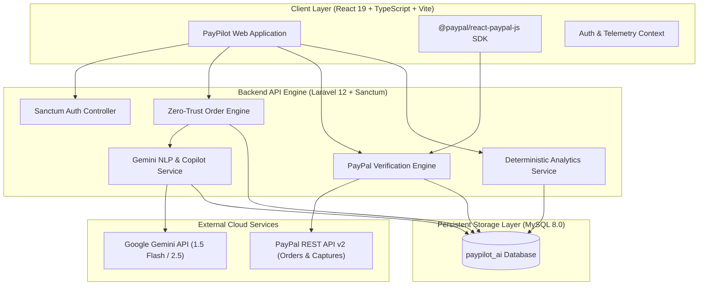
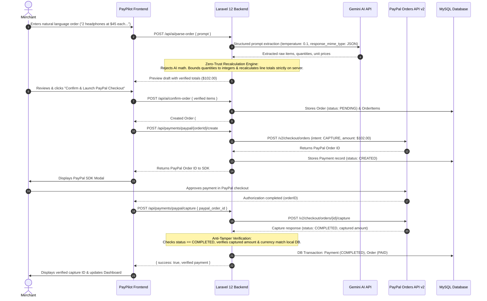

# PayPilot AI 🚀
### Autonomous Merchant Commerce Loop, PayPal v2 Verification & AI Copilot

[](https://developer.paypal.com/)
[](https://ai.google.dev/)
[](https://laravel.com/)
[](https://react.dev/)
[](https://tailwindcss.com/)
[](https://opensource.org/licenses/MIT)

**PayPal AI Hackathon 2026 Submission**  
**Repository:** [https://github.com/irfan-ibtech/PayPilot-AI.git](https://github.com/irfan-ibtech/PayPilot-AI.git)

---

## 📌 Executive Summary

Modern small-to-medium business (SMB) merchants operate in fragmented payment silos: manual quote generation leads to checkout abandonment, invoices are prone to human calculation errors, payment gateways operate disconnected from store intelligence, and business owners lack dedicated CFO-level insights to act upon their store transaction history.

**PayPilot AI** closes this gap by introducing an autonomous closed-loop commerce operating system:
1. **Natural Language Order Creation:** Merchants describe orders in plain English (e.g., *"2 wireless headphones at $45 each and one phone case at $12"*).
2. **Zero-Trust Pricing Recalculation:** The PHP backend engine rejects AI mathematical claims, strictly recalculating subtotals, quantities, and line items server-side to guarantee zero financial tampering.
3. **Instant PayPal v2 Checkout:** Generates PayPal Orders API v2 transactions, dynamically loads official PayPal Checkout buttons, and captures authorizations.
4. **Server-Side Anti-Tampering Verification:** Validates capture statuses, idempotency, and cryptographic amount/currency alignment prior to state settlement.
5. **Deterministic Financial Analytics & Gemini Copilot:** Ingests settled telemetry into a deterministic analytics engine and feeds ground-truth metrics into Google Gemini to provide executive CFO diagnostics and autonomous revenue recommendations.

---

## 🏗️ System Architecture

### 1. High-Level Component Topology



---

### 2. Zero-Trust Order Extraction & PayPal Capture Sequence



---

## 🔒 Zero-Trust Security & Pricing Architecture

Financial systems interacting with Large Language Models face critical vulnerabilities if AI output is treated as authoritative. PayPilot AI implements a strict **Zero-Trust Financial Architecture**:

1. **Client & AI Output Rejection:** The backend never trusts a price, subtotal, or total generated by the client or Gemini. When Gemini extracts order items, the PHP backend forces all quantities into bounded integers ($\ge 1$), rounds unit prices to 2 decimal places, and executes `line_total = round($quantity * $unit_price, 2)`.
2. **Server-Side Subtotal & Total Computation:** The `subtotal` and `total` stored in the database and submitted to PayPal are computed exclusively in PHP inside an atomic database transaction.
3. **Idempotency Guards:** The `POST /api/payments/paypal/capture` endpoint guards against replay attacks or double-capture attempts by querying existing payment states; completed payments return the verified record without issuing duplicate capture calls.
4. **Anti-Tampering Capture Verification:** When PayPal responds to a capture call, PayPilot inspects the capture payload:
   $$\left| \text{Captured Amount} - \text{Expected DB Total} \right| \le 0.01 \quad \land \quad \text{Captured Currency} \equiv \text{Expected Currency}$$
   If any discrepancy exists (e.g. an altered checkout payload or currency spoof), the transaction status is marked `FAILED` with an audit record, and the order is withheld.
5. **Credential Isolation:** The frontend dynamically queries `GET /api/payments/paypal/client-id` to initialize the `@paypal/react-paypal-js` SDK. `PAYPAL_CLIENT_SECRET` is never exposed to the client.

---

## ⚡ Key Features

- **Natural Language Order Creation:** Turn loose conversations, WhatsApp chats, or verbal quotes into clean invoices instantly.
- **Integrated PayPal Checkout:** Embedded `<PayPalButtons>` with real-time popup authorization and seamless sandbox support.
- **Deterministic Analytics Engine:** Accurate SQL aggregates for Verified Gross Revenue, Order Conversion Rate, Average Order Value (AOV), and 7-day time series.
- **Gemini CFO Copilot:** Conversational executive advisor grounded in store transaction metrics, producing categorized recommendations (`high`, `medium`, `low` priority).
- **Persistent Recommendations:** High-impact business actions (e.g., cart recovery paylinks, product bundles) automatically saved to `business_recommendations` for tracking.

---

## 🛠️ Tech Stack

| Layer | Technologies |
|---|---|
| **Backend API** | PHP 8.4+, Laravel 12, Laravel Sanctum, Guzzle/Http |
| **Database** | MySQL 8.0 (InnoDB, utf8mb4) |
| **Payment Engine** | PayPal REST API v2 (`/v1/oauth2/token`, `/v2/checkout/orders`, `/capture`) |
| **Artificial Intelligence** | Google Gemini API (`gemini-1.5-flash` / `gemini-2.5-flash`) |
| **Frontend SPA** | React 19, TypeScript, Vite, Tailwind CSS v4, Lucide Icons, Recharts |
| **PayPal SDK** | `@paypal/react-paypal-js` |

---

## 🚀 Quick-Start Installation Guide

### Prerequisites
- **PHP 8.2+** with extensions: `pdo_mysql`, `curl`, `mbstring`, `openssl`, `bcmath`
- **Composer 2.x**
- **Node.js 18+** & **npm**
- **MySQL 8.0+** (Running natively on port `3306` or via MAMP on port `8889`)

---

### Step 1: Clone Repository
```bash
git clone https://github.com/irfan-ibtech/PayPilot-AI.git
cd PayPilot-AI
```

---

### Step 2: Configure & Run Backend

1. Navigate to backend directory and install PHP packages:
   ```bash
   cd backend
   composer install
   ```

2. Configure environment file:
   ```bash
   cp .env.example .env
   php artisan key:generate
   ```

3. Configure your database and API credentials in `backend/.env`:
   ```env
   APP_NAME="PayPilot AI API"
   APP_URL=http://localhost:8000
   FRONTEND_URL=http://localhost:5173

   DB_CONNECTION=mysql
   DB_HOST=127.0.0.1
   DB_PORT=8889              # Or 3306 depending on your local MySQL setup
   DB_DATABASE=paypilot_ai
   DB_USERNAME=root
   DB_PASSWORD=root

   CORS_ALLOWED_ORIGINS=http://localhost:5173

   # PayPal Sandbox Credentials
   PAYPAL_MODE=sandbox
   PAYPAL_CLIENT_ID=your_paypal_sandbox_client_id
   PAYPAL_CLIENT_SECRET=your_paypal_sandbox_secret

   # Google Gemini API Key
   GEMINI_API_KEY=your_gemini_api_key
   GEMINI_MODEL=gemini-1.5-flash
   ```

4. Create database and run migrations with seeders:
   ```bash
   # Ensure database 'paypilot_ai' exists, then run:
   php artisan migrate:fresh --seed
   ```
   *Seeder automatically creates:*
   - Demo Merchant: `demo@paypilot.ai` / `password123`
   - 5 catalog items (Headphones, Keyboards, Hubs, Cases, Mousepads)
   - 12 realistic orders spread across 7 days (8 `PAID`, 3 `PENDING`, 1 `FAILED`) with PayPal telemetry.

5. Start the backend development server:
   ```bash
   php artisan serve --port=8000
   ```

---

### Step 3: Configure & Run Frontend

1. In a new terminal window, navigate to `frontend/`:
   ```bash
   cd frontend
   npm install
   ```

2. Start the Vite development server:
   ```bash
   npm run dev
   ```
   Open [http://localhost:5173](http://localhost:5173) in your browser.

3. Log in with the pre-seeded demo merchant credentials:
   - **Email:** `demo@paypilot.ai`
   - **Password:** `password123`
   *(Or click "Fill Hackathon Demo Credentials" for 1-click login).*

---

## 🧪 Testing the API via curl

### 1. Merchant Authentication
```bash
TOKEN=$(curl -s -X POST http://127.0.0.1:8000/api/login \
  -H "Content-Type: application/json" \
  -H "Accept: application/json" \
  -d '{"email":"demo@paypilot.ai","password":"password123"}' | grep -o '"token":"[^"]*' | cut -d'"' -f4)
echo "Auth Token: $TOKEN"
```

### 2. Natural Language Order Extraction & Zero-Trust Calculation
```bash
curl -X POST http://127.0.0.1:8000/api/ai/parse-order \
  -H "Authorization: Bearer $TOKEN" \
  -H "Content-Type: application/json" \
  -H "Accept: application/json" \
  -d '{"prompt":"2 wireless headphones at $45 each and one phone case at $12"}'
```

### 3. Consult AI Copilot with Store Metrics
```bash
curl -X POST http://127.0.0.1:8000/api/ai/copilot/ask \
  -H "Authorization: Bearer $TOKEN" \
  -H "Content-Type: application/json" \
  -H "Accept: application/json" \
  -d '{"question":"Analyze my sales performance and recommend three actions to improve revenue."}'
```

---

## 📹 Demo Video & Devpost Information

- **Devpost Submission:** PayPal AI Hackathon 2026
- **Live Demo Video:** *[Insert YouTube / Loom Video Link]*
- **Author & Lead Engineer:** Muhammad Irfan Bashir ([@irfan-ibtech](https://github.com/irfan-ibtech))

---

## 📄 License

This project is open-source software licensed under the **[MIT License](LICENSE)**.  
Copyright (c) 2026 Muhammad Irfan Bashir / IB Tech (PayPilot AI Contributors).
